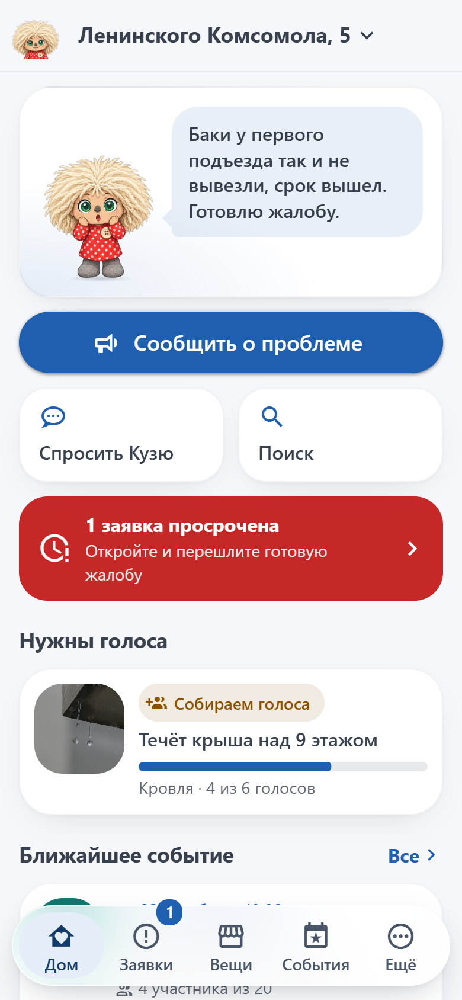
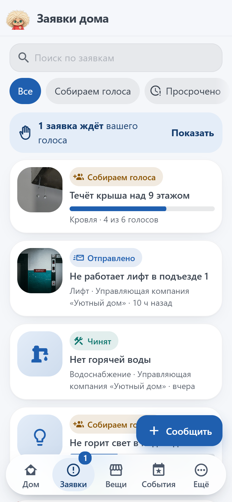
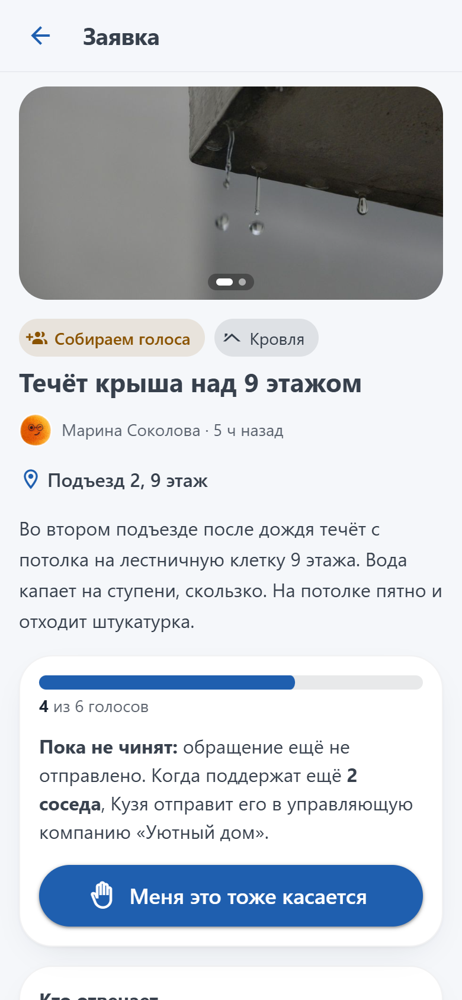
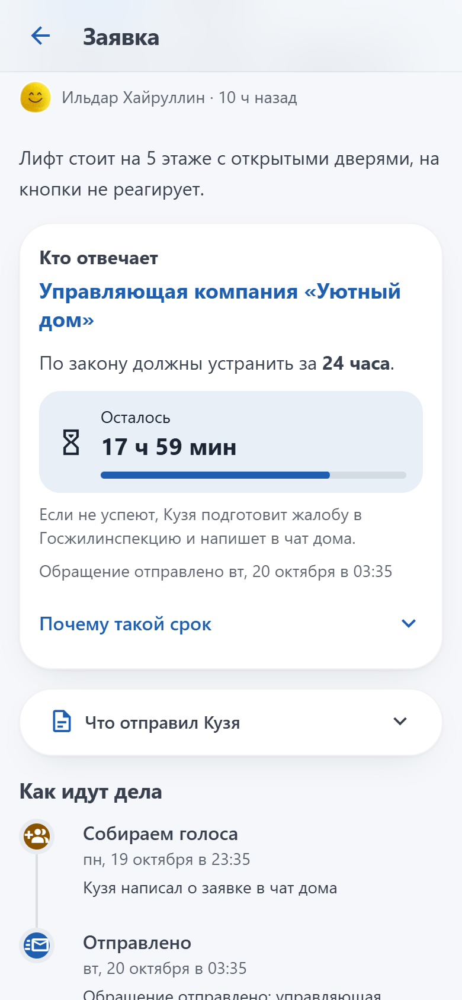
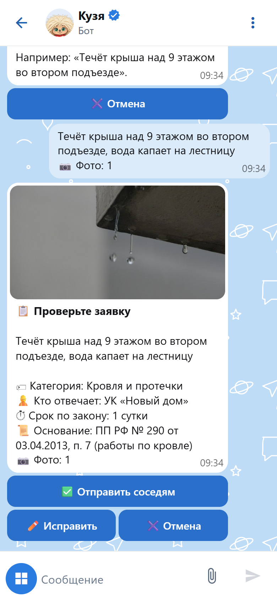
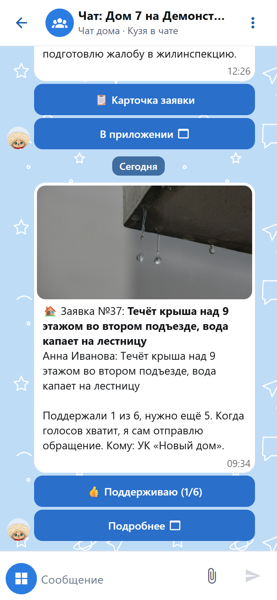
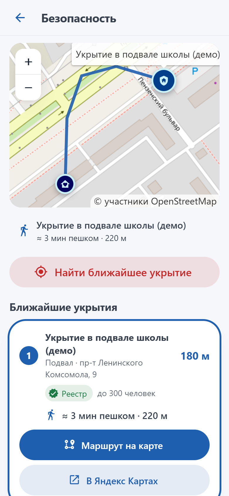
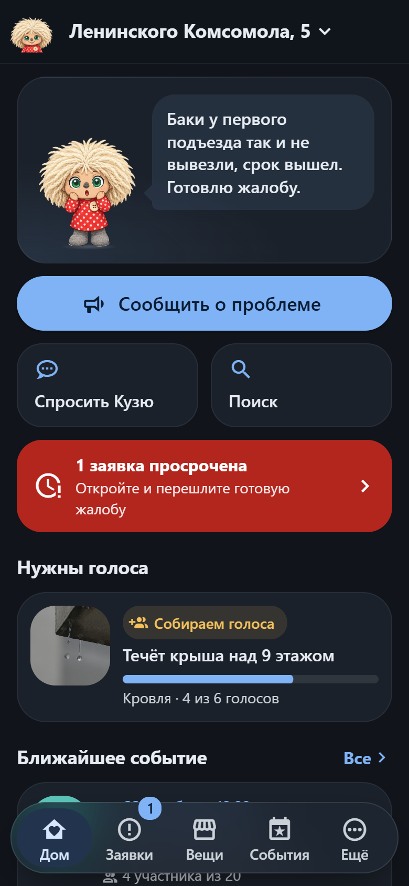

# Домовой Кузя

Чат-бот и мини-приложение MAX для жителей многоквартирного дома. Кузя живёт в домовом чате: превращает жалобы соседей в коллективное обращение с правильным адресатом и сроком по закону, следит за исполнением, собирает соседей на субботники, ведёт доску вещей, модерирует чат и подсказывает ближайшее укрытие при беспилотной опасности.

Трек «Умный город», команда MISIS MOJARUNG. Пилот: многоквартирный дом в Ульяновске.

- Бот в MAX: https://max.ru/id732818139220_bot
- Мини-приложение: https://linkog.ru (открывается кнопкой в чате бота)
- Презентация для финала: [Презентация_Домовой_Кузя_v2.pdf](Презентация_Домовой_Кузя_v2.pdf)

## 1. Краткий запуск

Нужен Docker 24+ с Compose v2. Одна команда из корня репозитория:

```bash
docker compose up -d --build
```

Сборка с нуля занимает около 2,5 минут. Файл `.env` не нужен: без него всё стартует в мок-режиме с демо-домом, токены не требуются.

| Адрес | Что там |
|---|---|
| http://localhost:8180 | мини-приложение с демо-жителями |
| http://localhost:8180/dev/chat | эмулятор чата MAX с ботом |
| http://localhost:8025 | Mailpit: тестовые письма с обращениями |
| http://localhost:8000/docs | Swagger API |

Проверить основной сценарий за минуту: откройте эмулятор чата, в меню «⋮» выберите личку с ботом, нажмите синюю кнопку меню → «Меню» → «Сообщить о проблеме», приложите фото и напишите «течёт крыша над 9 этажом». Придёт карточка с категорией, исполнителем и сроком по закону. «Отправить соседям» публикует заявку в чате дома с кнопкой «Поддерживаю».

Остановить: `docker compose stop`, запустить снова: `docker compose start`. Остальные режимы запуска в разделе [4.4](#44-запуск-подробно).

## 2. Скриншоты

<p align="center">
  
  
  
  
</p>
<p align="center">
  
  
  
  
</p>

Все экраны: [docs/presentation_v2/shots](docs/presentation_v2/shots).

## 3. Основные функции

| Функция | Где | Что получает житель |
|---|---|---|
| Заявки о поломках | чат MAX, приложение | фото и пара слов → Кузя определяет категорию, исполнителя и срок по закону → соседи голосуют → на пороге (15% участников чата) уходит обращение → отсчёт срока → при просрочке готовая жалоба в Госжилинспекцию |
| Всё основное в чате | чат MAX | меню на кнопках: заявка с фото, голос, карточка заявки, обращение и жалоба, списки заявок, события, вещи, укрытия, профиль, выбор дома. Приложение не обязательно |
| Поиск дублей | чат, приложение | «об этом уже сообщили, поддержите голосом» вместо десяти одинаковых заявок |
| Укрытия по всей России | чат, приложение | реестр укрытий региона, а где его нет, заглублённые объекты из OpenStreetMap: паркинги, переходы, метро. Маршрут пешком на карте и ссылка в Яндекс Карты |
| Тревоги по регионам | чат, приложение | Кузя читает официальные ленты МЧС и губернаторов и сам запускает тревогу только в домах своего региона: памятка на весь экран, ближайшее укрытие, сообщение в чат |
| События двора | чат, приложение | субботник одной фразой «Кузя, создай субботник в субботу в 11», запись «Иду», описание и фото, напоминание |
| Вещи соседей | чат, приложение | отдать даром или продать, фото листаются, связь с продавцом через бота |
| Кузя-агент | чат, приложение | понимает свободный текст, помнит контекст чата, создаёт заявки, события и объявления |
| Модерация | чат | мат, оскорбления, реклама и спам удаляются, после трёх предупреждений Кузя пишет администраторам |
| Дом из чата | чат, приложение | дом и соседи появляются сами, администратор чата становится администратором дома, вышедший из чата теряет доступ |
| Очки и соседи | приложение | очки и награды за участие, профили соседей, «Спасибо» и сообщение соседу без раскрытия номера |
| Документы и объявления | приложение, чат | документы дома и личные, объявления с закреплением в чате |

**Закон не выдумывается.** Нейросеть только выбирает категорию проблемы. Исполнитель, основание и срок берутся из справочника `backend/src/domovoy/modules/issues/catalog.py` со ссылками на ПП РФ № 290, 354, 491, постановление Госстроя № 170, 59-ФЗ и 131-ФЗ.

**Кузя - тамагочи дома.** Настроение маскота считается из данных: просроченные заявки его огорчают, решённые проблемы и события радуют, во время тревоги он переходит в режим оповещения.

## 4. Подробно

### 4.1. Проблема и пользователь

**Кто:** житель панельной девятиэтажки (40-150 квартир) с активным домовым чатом, чаще всего председатель совета дома или неравнодушный сосед.

**Ситуация:** в доме течёт крыша. В чате 30 сообщений «у нас тоже», никто не знает, кому писать (УК, регоператор ТКО, администрация района), какой срок положен по закону и подал ли уже кто-нибудь заявку. Обсуждение не превращается в действие, а если заявку всё же подают, её статус никто не отслеживает.

С 01.09.2026 управляющие организации обязаны взаимодействовать с жителями через MAX (ПП РФ № 40 от 26.01.2026). Кузя встраивается в этот канал там, где жители уже общаются: в домовой чат.

**Чем это отличается от «Госуслуги.Дом».** Там есть заявки и даже коллективная заявка, но в отдельном приложении, только для собственников и только в управляющую организацию. Коллективных среди 1,5 млн заявок за январь-апрель 2025 было 8,5%. Кузя собирает поддержку соседей прямо в чате, определяет адресата не только среди УК и показывает срок по закону. Сравнение с источниками: [docs/PRODUCT.md](docs/PRODUCT.md#чем-кузя-отличается-от-того-что-уже-есть).

**Почему Ульяновск.** Режим «беспилотная опасность» здесь объявляют несколько раз в неделю, а мобильный интернет в части районов ограничен. MAX входит в белый список и работает при ограничениях, поэтому Кузя в чате остаётся на связи. В домовых чатах MAX уже больше 128 тыс. ульяновцев (5 тыс. чатов), и регион сам ставит задачу сделать их инструментом работы с УК. Факты и источники: [docs/PRODUCT.md](docs/PRODUCT.md#почему-пилот-в-ульяновске).

### 4.2. Основной сценарий

1. Житель в домовом чате MAX нажимает «Сообщить о проблеме» (или открывает мини-приложение).
2. Присылает фото и пишет «течёт крыша над 9 этажом». Кузя показывает карточку: «Кровля и протечки → УК, срок 1 сутки» и проверяет дубли.
3. Заявка публикуется в чате дома с кнопкой «👍 Поддерживаю (1/6)». Порог 6 = 15% от 40 участников чата.
4. Соседи голосуют в чате или в приложении, счётчик обновляется у всех без перезагрузки.
5. На шестом голосе Кузя формирует обращение (адресат, основание, срок, число подписавшихся), отправляет исполнителю и пишет в чат срок.
6. В карточке заявки видны статус, отсчёт срока и текст обращения. При просрочке Кузя готовит жалобу в Госжилинспекцию и сообщает в чат.
7. Когда проблему устранили, автор отмечает «Решено», жители получают очки, у Кузи улучшается настроение.

### 4.3. Кузя в чате без приложения

Весь основной сценарий проходится в чате MAX, мини-приложение нужно для карты и длинных списков.

- **Меню на кнопках.** `/меню` или `/start` в личке показывают кнопки: сообщить о проблеме, заявки дома, мои заявки, события, вещи соседей, укрытия, профиль, выбор дома. В чате дома меню короче.
- **Заявка с фото.** «Сообщить о проблеме» или `/новая`, затем описание одним сообщением и до пяти фото. Перед публикацией приходит карточка: категория, кто отвечает, срок, основание, число фото и похожая открытая заявка. Кнопки «Отправить соседям», «Исправить», «Отмена». В чате дома Кузя ловит описание, если к нему обратиться по имени или ответить на его сообщение.
- **Карточка заявки** (`issue:N`): статус, голоса, исполнитель, срок с отсчётом, ход заявки. Автор или администратор отмечает «В работе» и «Решено», любой житель открывает текст обращения и жалобу после просрочки.
- **Списки:** `/проблемы`, `/мои`, `/события` (запись «Иду» прямо из списка), `/вещи` (карточка с фото и «Написать продавцу»), `/укрытия` (три ближайших с маршрутом), `/профиль`, `/дом`.
- **Текстом без кнопок:** «Кузя, пахнет газом …», «заведи заявку: …», «поддерживаю заявку 5» понимает и заглушка без LLM.

Код: `backend/src/domovoy/bot/chat_flows.py`. Черновик заявки хранится в памяти процесса бота 30 минут.

### 4.4. Запуск подробно

**Docker** (основной способ):

```bash
docker compose up -d --build   # собрать и запустить всё
docker compose stop            # остановить, данные сохраняются
docker compose start           # запустить снова
docker compose down            # удалить контейнеры, данные в томах остаются
docker compose down -v         # удалить и данные; при следующем запуске демо-данные создадутся заново
```

| Адрес | Что там |
|---|---|
| http://localhost:8180 | мини-приложение (в браузере работает в мок-режиме) |
| http://localhost:8180/dev/chat | эмулятор чата MAX: экран как в самом MAX, чат и демо-жителя меняют в меню «⋮» |
| http://localhost:8000/docs | Swagger API |
| http://localhost:8765/mcp | MCP-сервер «Жилищный навигатор» |
| http://localhost:15672 | RabbitMQ (domovoy / domovoy) |
| http://localhost:9001 | консоль MinIO (domovoy / domovoy-secret) |
| http://localhost:8025 | Mailpit: тестовые письма с обращениями |

**Локально через uv**, без сборки образов приложения:

```bash
docker compose up -d postgres rabbitmq minio           # только инфраструктура; значения по умолчанию совпадают с compose
cd backend && uv sync
uv run domovoy mcp & uv run domovoy api & uv run domovoy bot & uv run domovoy worker
cd ../frontend && npm ci && npm run dev                # http://localhost:5173
```

Мок-режим фронтенда без бэкенда: `cd frontend && npm run dev:mock` → http://localhost:5174, сценарии `?scenario=empty|overdue|alert|error`.

**Подключение к MAX:**

1. Получить токен бота у организаторов, записать в `.env`: `MAX_BOT_TOKEN=...`, `MAX_BOT_USERNAME=<ник без @>`.
2. Опубликовать фронтенд по HTTPS (MAX открывает мини-приложения только по HTTPS), например `cloudflared tunnel --url http://localhost:8180`.
3. В business.max.ru → Чат-боты → Настройки указать URL мини-приложения.
4. `MOCK_MAX=false`, затем `docker compose up -d`.
5. Добавить бота в домовой чат **администратором** с правами «Читать сообщения» и «Удалять сообщения». Без прав администратора MAX не доставляет боту сообщения группы. Кузя сразу сверяет участников: у каждого дом появляется в приложении, администраторы чата становятся администраторами дома.
6. Ник бота (`MAX_BOT_USERNAME`) должен совпадать с настоящим, например `id732818139220_bot`: по нему строятся диплинки. Бот при старте сверяет ник с `GET /me`.

**Сервер с HTTPS.** Нужен VPS от 2 ГБ RAM и 1 vCPU, Docker 24+, домен с A-записью, открытые порты 80 и 443:

```bash
DOMAIN=kuzya.example.ru docker compose -f compose.yaml -f compose.https.yaml up -d --build
```

`deploy/dc.sh` - та же команда короче. Caddy (`deploy/Caddyfile`) сам получает сертификат Let's Encrypt и проксирует на фронтенд, SSE не буферизуется. Наружу открыты только 80 и 443, у сервисов заданы лимиты памяти под 2 ГБ. На сервере с 2 ГБ RAM нужен swap 2 ГБ, иначе сборка фронтенда упирается в память. Эмулятор и настоящий MAX работают одновременно: демо-чат обслуживает эмулятор, настоящие чаты идут через Bot API.

### 4.5. Архитектура


Модульный монолит: один Python-пакет `domovoy`, четыре процесса из одного образа. Каждый процесс масштабируется отдельно (`docker compose up --scale worker=3`), связь через RabbitMQ.

| Компонент | Процесс | Роль |
|---|---|---|
| `api` | `domovoy api` | REST API мини-приложения, SSE-поток обновлений, эмулятор чата, Swagger |
| `bot` | `domovoy bot` | long polling MAX Bot API, модерация, агент, сценарии в чате, отправка сообщений из очереди `bot.send` |
| `worker` | `domovoy worker` | формирует обращения, раз в минуту напоминает о событиях, эскалирует просрочки, опрашивает официальные ленты тревог |
| `mcp` | `domovoy mcp` | MCP-сервер «Жилищный навигатор» (streamable HTTP, `/mcp`) |
| `frontend` | nginx | статика мини-приложения, проксирует `/api` в `api` |

Модули бэкенда (`backend/src/domovoy/modules`): `users`, `issues`, `market`, `events`, `achievements`, `safety`, `moderation`, `search`, `assistant`, `announcements`, `documents`, `devchat`. У модуля свои модели, сервис и роутер; бот, агент и REST вызывают одни и те же сервисы.

**Почему REST, а не gRPC или GraphQL.** Мини-приложение работает в WebView: gRPC там требует gRPC-Web и прокси, GraphQL добавляет слой схемы без выигрыша на простых экранах. REST с узкими ответами, HTTP-кэшем для фото и SSE для живых обновлений проще отлаживать. Контракт: [docs/API.md](docs/API.md), OpenAPI: [docs/openapi.json](docs/openapi.json).

**RAG-поиск.** Гибридный ретривер в Postgres: вектор pgvector (косинус) и полнотекстовый индекс с русской морфологией, веса 0,6 и 0,4. Эмбеддинги считает локальный хэширующий эмбеддер на символьных триграммах со словарём бытовых синонимов («протекает крыша» ≈ «течь кровли»), поэтому поиск работает без сети и GPU.

**Агент.** `langchain.agents.create_agent` (LangGraph) с инструментами-замыканиями: модель не может подставить чужой `user_id` или дом. Память в Postgres (`AsyncPostgresSaver`), поток на чат. Облачная модель при сбое падает на stub, длинная история сворачивается.

**Укрытия и маршрут.** `modules/safety`: сначала база, а если рядом мало точек, заглублённые объекты из OpenStreetMap через Overpass с кэшем на неделю. Пешеходный маршрут строит OSRM, при сбое рисуется прямая с оценкой времени. Реестр региона загружается из CSV: `uv run domovoy import-shelters file.csv --region RU-ORL --source "..."`, формат в [backend/data/shelters/README.md](backend/data/shelters/README.md).

**Официальные оповещения по регионам.** У дома есть регион (`houses.region`, код ISO 3166-2 вроде `RU-ULY`), он определяется по адресу. Воркер раз в минуту опрашивает источники региона: RSS сайтов МЧС всех 89 регионов, публичные Telegram-каналы ГУ МЧС и губернатора, при наличии ключа сообщества ВКонтакте. Канал в MAX подключается без парсинга: регион добавляет Кузю администратором канала оповещений. Только белый список источников, автоотбой через 6 часов. Подробности: [docs/ALERTS.md](docs/ALERTS.md).

### 4.6. Переменные окружения и порты

Полный список с комментариями: [.env.example](.env.example).

| Переменная | По умолчанию | Назначение |
|---|---|---|
| `MAX_BOT_TOKEN` | пусто | токен бота MAX; пусто = работает только эмулятор чата |
| `MAX_BOT_USERNAME` | `domovoy_kuzya_bot` | ник бота для диплинков `https://max.ru/<ник>?startapp=...` |
| `MAX_API_URL` | `https://platform-api2.max.ru` | адрес Bot API |
| `MOCK_MAX` | `true` | вход без подписи MAX (`X-Dev-User`), демо-жители, эмулятор чата |
| `SEED_DEMO` | `true` | создать демо-дом при первом запуске |
| `LLM_PROVIDER` | `stub` | `stub`, `ollama_cloud` или `ollama_local` |
| `LLM_MODEL` | `gpt-oss:120b` | модель Ollama |
| `OLLAMA_API_KEY` | пусто | ключ Ollama Cloud |
| `OLLAMA_LOCAL_URL` | `http://host.docker.internal:11434` | локальная Ollama |
| `EXTRA_MCP_SERVERS` | `[]` | JSON со списком внешних MCP-серверов |
| `DEFAULT_VOTE_THRESHOLD_PCT` | `15` | порог голосов, % от участников чата |
| `MIN_VOTES_NEEDED` | `3` | минимальный порог для маленьких чатов |
| `EVENT_REMINDER_MINUTES` | `120` | за сколько минут напоминать о событии |
| `APPEAL_TEST_EMAIL` | `uk-test@domovoy.local` в compose | тестовый адрес, куда уходит обращение вместо УК |
| `SMTP_HOST`, `SMTP_PORT`, `SMTP_USER`, `SMTP_PASSWORD`, `SMTP_SSL`, `SMTP_STARTTLS`, `SMTP_FROM` | `mailpit:1025` в compose | почта для тестовых писем; пустой `SMTP_HOST` = письма не отправляются |
| `ALERT_FEEDS_ENABLED`, `ALERT_FEED_INTERVAL_SECONDS`, `ALERT_FEED_MAX_HOURS` | `true`, `60`, `6` | опрос официальных лент тревог, период и автоотбой |
| `VK_SERVICE_TOKEN` | пусто | сервисный ключ ВКонтакте для лент сообществ |
| `FILES_SECRET` | из токена бота и ключа MinIO | ключ подписи временных ссылок на документы |
| `WEB_PORT`, `API_PORT`, `MCP_PORT`, `POSTGRES_PORT`, `RABBIT_PORT`, `RABBIT_UI_PORT`, `MINIO_PORT`, `MINIO_CONSOLE_PORT` | 8180, 8000, 8765, 5432, 5672, 15672, 9000, 9001 | порты на хосте |

### 4.7. Зависимости

Версии зафиксированы в `backend/uv.lock` и `frontend/package-lock.json`.

- Бэкенд: Python 3.13, FastAPI, SQLAlchemy 2 (asyncpg), pgvector, FastStream (RabbitMQ), miniopy-async, LangChain 1.x, LangGraph 1.x, langgraph-checkpoint-postgres, langchain-ollama, FastMCP, sse-starlette, Pillow, structlog, httpx.
- Фронтенд: Vue 3, Vite, TypeScript, Pinia, Vue Router, Vuetify 4, shadcn-vue и Tailwind CSS 4, GSAP, Leaflet.
- Инфраструктура: PostgreSQL 18 с pgvector, RabbitMQ 4, MinIO, Mailpit.
- Инструменты: uv, ruff, mypy, pytest, pytest-cov; ESLint, Prettier, vue-tsc, Vitest.

### 4.8. Внешние сервисы и интеграции

| Сервис | Зачем | Статус в MVP |
|---|---|---|
| MAX Bot API | бот в чатах | реальная интеграция, нужен токен |
| MAX Bridge (`max-web-app.js`) | данные пользователя, кнопка «Назад», вибро, ссылки | реальная интеграция, подпись `initData` проверяется на сервере |
| Участники и администраторы чата | права в доме, автодобавление домов | реальная интеграция через `GET /chats/{id}/members`, нужен бот-администратор чата |
| Ollama Cloud | агент, классификация, деловой стиль обращений, модерация | опционально, без ключа работает stub |
| OpenStreetMap: тайлы, Nominatim, Overpass | карта, координаты и регион дома, заглублённые укрытия | реальная |
| OSRM (routing.openstreetmap.de) | пешеходный маршрут до укрытия | реальная, при сбое прямая линия |
| Яндекс Карты | маршрут по ссылке `yandex.ru/maps/?rtext=...&rtt=pd` | ссылка |
| Ленты МЧС, Telegram, ВКонтакте, каналы MAX | официальные оповещения о беспилотной опасности | реальная, белый список источников |
| Отправка обращения в УК | e-mail УК или ГИС ЖКХ | **модельная**: письмо с текстом и фото уходит на тестовый адрес `APPEAL_TEST_EMAIL` (его ловит Mailpit), тема помечена «[ТЕСТ]». В карточке заявки и в чате прямо написано, что это тестовый режим |
| ГИС ЖКХ (паспорт, тарифы, капремонт) | «Жилищный навигатор» | **модельные данные** в MCP-сервере, помечены в ответах |

Внутри Docker не воспроизводятся только MAX и Ollama Cloud. Без них проверка идёт через эмулятор чата и stub-LLM.

### 4.9. Работа с данными

- Персональные данные: имя, фамилия, ник и фото из MAX, номер квартиры по желанию. Телефоны не собираются.
- Фото перед сохранением пересжимаются до 1600 px, EXIF и геотеги удаляются, в MinIO лежат только JPEG.
- Журнал модерации хранит только сработавшие сообщения; обычная переписка чата в базе не сохраняется. Память агента хранит диалоги с ботом.
- Доступ: житель видит только данные своего дома; менять статус заявки может автор или администратор.
- Секреты только в `.env`, в репозитории `.env.example` без значений.

### 4.10. Тестовые данные

При первом запуске (`SEED_DEMO=true`) создаётся вымышленный дом «Дом 7 на Демонстрационной» (Ульяновск) с 40 участниками чата и порогом 6 голосов:

- 8 демо-жителей (MAX id 1001-1008), Анна Иванова (1001) администратор дома;
- второй демо-дом «Дом 9 на Примерной», где живут Анна и Олег: видно переключение домов;
- 5 заявок в разных статусах: на голосовании, отправленная, просроченная, решённая;
- объявления, документы, 5 вещей соседей с фото, 3 события;
- 6 демо-укрытий, демо-УК и справочник исполнителей.

Все организации, адреса и укрытия вымышленные и помечены «(демо)». Сбросить данные: `docker compose down -v && docker compose up -d`.

### 4.11. Пошаговая проверка вручную

1. Откройте http://localhost:8180. В шапке выберите жителя «Светлана Козлова».
2. Главная: Кузя встревожен (есть просроченная заявка), видны заявки, которым нужны голоса.
3. «Заявки» → «Сообщить»: добавьте фото, введите «течёт кран в подвале». Появится подсказка категории и исполнителя, затем карточка заявки 1/6.
4. Переключайтесь на других жителей и нажимайте «Поддерживаю». На шестом голосе статус станет «Отправлено», через пару секунд появятся текст обращения и отсчёт срока.
5. Эмулятор чата (`/dev/chat`): видны сообщения Кузи о заявке. Напишите «Кузя, создай субботник в воскресенье в 12 у площадки», событие появится в чате и во вкладке «События».
6. В личке с ботом нажмите «Меню» → «Сообщить о проблеме» → скрепка, фото → «На 9 этаже с потолка капает вода». Придёт карточка «Проверьте заявку» с категорией «Кровля и протечки», УК и сроком 1 сутки.
7. Напишите в чате дома «Ты дурак, блин»: сообщение удалится, Кузя выдаст предупреждение 1/3.
8. «Ещё» → «Безопасность»: выберите укрытие, на карте появится пешеходный маршрут. «Тестовая тревога» показывает оповещение на всех открытых вкладках.
9. «Ещё» → «Спросить Кузю»: «Какие тарифы на воду?» (ответ из MCP-сервера), «Какие проблемы в доме?».

Без MAX и без Docker: мини-приложение, открытое в обычном браузере, показывает экран «Кузя живёт в MAX» со ссылкой на бота и кнопкой «Посмотреть демо в браузере». Демо работает на вымышленном доме прямо во вкладке, в настоящий чат и УК ничего не уходит.

### 4.12. Примеры ожидаемого поведения

| Действие | Результат |
|---|---|
| `POST /api/v1/issues` с «пахнет газом в подъезде» | категория «Запах газа», заявка сразу уходит в аварийную службу без голосования, в чате инструкция звонить 104/112 |
| Шестой голос за заявку | статус `sent`, `deadline_at` = сейчас + норматив, через 1-2 с заполнен `appeal_text` |
| Комментарий «Ты дурак» | `422 {"detail": "Кузя не пропустил комментарий: оскорбление. Давайте вежливо 🙏"}` |
| В чате «Кузя, где укрытие?» | три ближайших укрытия с видом и источником, ссылки на маршрут и кнопка «Карта укрытий» |
| `GET /api/v1/shelters/{id}/route` | `{distance_m, duration_s, points, provider: "osrm"}`, при сбое `provider: "straight"` |
| Просрочка нормативного срока | в ленте заявки текст жалобы в Госжилинспекцию, Кузя сообщает в чат |
| Повторный голос | `409 {"detail": "Вы уже поддержали эту заявку"}` |

### 4.13. Известные ограничения

- Отправка обращения исполнителю модельная: письмо уходит на тестовый адрес. Для пилота нужна договорённость с УК об e-mail (он задаётся в настройках дома) или интеграция с ГИС ЖКХ.
- Реестры укрытий есть не у всех регионов; где их нет, Кузя предлагает заглублённые объекты OpenStreetMap, это подсказка, а не официальное защитное сооружение. Публичные серверы Overpass бывают перегружены, тогда ответ идёт из базы.
- Тревоги из лент зависят от того, где регион публикует оповещения. Публичная веб-версия Telegram и RSS МЧС не договорные интерфейсы, целевой путь - канал региона в MAX с Кузей-администратором.
- Права и автодобавление домов опираются на список участников чата: если Кузя не администратор чата, MAX его не отдаёт.
- Миграции схемы сделаны идемпотентными `ALTER TABLE ... ADD COLUMN IF NOT EXISTS` в `core/db.py`; для продакшена нужен Alembic.
- Нормативные сроки в справочнике перед пилотом должен подтвердить юрист УК; для других регионов справочник дополняется.
- Long polling MAX по документации не рекомендован для продакшена; для пилота нужен webhook и публичный HTTPS-адрес бота.
- При ограничении мобильного интернета работает белый список: бот в чате MAX доступен, мини-приложение на своём домене открывается только через Wi-Fi.
- Хэширующий эмбеддер уступает нейросетевым в семантике; для крупных домов стоит подключить эмбеддинги Ollama.

### 4.14. Масштабирование

Не меняется при переносе в другой дом, УК или регион: сценарий «фото → голоса → обращение → контроль срока», модель данных, бот, мини-приложение, агент.

Настраивается: справочник исполнителей и нормативов (`issues/catalog.py`, таблица `organizations`), канал отправки обращения в конкретную УК, реестр укрытий и источники тревог региона, региональные тарифы и капремонт (MCP-сервер).

Порядок тиражирования: один дом в Ульяновске → все дома одной УК → УК Ульяновска через управление ЖКХ города → регионы Поволжья → другие регионы с их нормами. Риски и кто платит: [docs/PRODUCT.md](docs/PRODUCT.md#риски-масштабирования).

### 4.15. Презентация и ролик

Презентация для финала: [Презентация_Домовой_Кузя_v2.pdf](Презентация_Домовой_Кузя_v2.pdf), 21 слайд: 19 для выступления и 2 в приложении. Порядок рассчитан на бизнес-жюри: продукт и сценарий в чате, что изменилось после онлайн-этапа, бизнес-модель, метрики, пилот и риски, потом архитектура, стек, проверки и нагрузка, в конце QR-код бота, источники и служебный слайд для технической проверки. Исходник `docs/presentation_v2/slides.html`, скрипты съёмки и сборки в `docs/presentation_v2/tools`:

```bash
uv run --with playwright --with pymupdf python docs/presentation_v2/tools/render.py
```

Ролик на 30 секунд (2560×1440, 60 кадров в секунду) с 3D-моделью iPhone и Кузей: исходник и сборка в [docs/presentation_v2/video](docs/presentation_v2/video/README.md). Готовый файл не хранится в репозитории из-за размера, он лежит в пакете сдачи и собирается заново одной командой.

Первая версия презентации, с отборочного этапа: [Презентация_Домовой_Кузя.pdf](Презентация_Домовой_Кузя.pdf), исходник `docs/presentation/slides.html`.

### 4.16. Структура репозитория

```
backend/            Python-пакет domovoy (api, bot, worker, mcp), тесты, Dockerfile
  src/domovoy/core      конфиг, БД, шина, хранилище, подпись MAX, эмбеддинги, SSE-хаб
  src/domovoy/modules   доменные модули: модели, сервисы, роутеры
  src/domovoy/agent     ReAct-агент, инструменты, MCP-адаптер, stub-LLM
  src/domovoy/bot       клиент MAX Bot API, шлюзы MAX/эмулятор, сценарии в чате
  src/domovoy/worker    обращения, напоминания, эскалации
  src/domovoy/mcp_server  MCP-сервер «Жилищный навигатор»
  data/shelters         формат реестра укрытий для импорта
  tests                 юнит-тесты pytest
frontend/           мини-приложение Vue 3, Dockerfile, nginx.conf
  src/mock              мок-бэкенд для браузерного демо
  public/demo           фото демо-заявок и объявлений (Unsplash, источники в CREDITS.md)
docs/               контракт API, OpenAPI, тревоги, продуктовое обоснование
  presentation_v2       финальная презентация, скриншоты, ролик
deploy/             Caddyfile и dc.sh для сервера с HTTPS
scripts/            сквозные проверки стенда: smoke.py, smoke_features.py, smoke_bot.py
compose.yaml        запуск всех компонентов одной командой
compose.https.yaml  оверрайд для сервера: Caddy, HTTPS, лимиты памяти
```

## 5. Тесты и покрытие

Все проверки проходят на текущем коммите. Замер 25.10.2026: **1374 автоматические проверки, покрытие строк кода 98% на бэкенде и 98% на фронтенде.**

| Уровень | Проверок | Что проверяют | Команда |
|---|---|---|---|
| Тесты бэкенда | 419 | 226 юнит-тестов (подпись MAX, классификация и справочник сроков, модерация, разбор дат, укрытия, маршруты, ленты тревог) и 193 интеграционных с настоящим Postgres: все эндпоинты API, сценарии бота в чате, воркер (обращения, напоминания, просрочки), агент и MCP, права и членство в домах | `cd backend && uv run pytest` |
| Тесты фронтенда | 837 | все компоненты и экраны, сторы, composables, API-клиент, роутер и мост MAX; экраны ходят в настоящие сторы и API-клиент, данные отдаёт мок-бэкенд | `cd frontend && npm test` |
| Сквозные проверки на стенде | 74 | API (17), функции (30), бот без приложения (27): заявка с фото, порог и обращение, письмо в Mailpit, модерация, дома и права, события, вещи, укрытия | `uv run --project backend python scripts/smoke.py` (и `smoke_features.py`, `smoke_bot.py`) |
| Аудит экранов | 44 | 22 экрана в светлой и тёмной теме: доступность по WCAG AA (axe), тач-зоны от 44 px, мелкий текст, переполнение | `npm run dev:mock`, затем `await __ui.audit()` в консоли |
| Статический анализ | | ruff с правилами безопасности (bandit), mypy, vue-tsc, ESLint, Prettier | `uv run ruff check . && uv run mypy src`, `npm run lint && npm run typecheck` |

**Покрытие бэкенда: 98% строк** (5788 из 5929), считает одна команда:

```bash
cd backend && uv run pytest --cov=src/domovoy --cov-report=term
```

Интеграционным тестам нужен Postgres с pgvector на localhost:5432 (подходит Postgres из `docker compose`). Тесты создают отдельную базу `domovoy_test` и удаляют её после прогона, демо-базу не трогают. RabbitMQ, MinIO, внешняя сеть, SMTP и MAX заменены заглушками в памяти, поэтому тест не может уйти наружу. Без Postgres интеграционные тесты пропускаются сами, юнит-тесты отдельно: `uv run pytest -m "not integration"`. Прогон с покрытием занимает около 30 секунд.

| Модуль | Строк | Покрыто |
|---|---|---|
| `modules/safety` (укрытия, маршруты, тревоги) | 1009 | 96% |
| `bot` (сценарии в чате, модерация) | 1199 | 97% |
| `modules/users` (дома, права, соседи, пульс) | 683 | 99% |
| `agent` | 529 | 96% |
| `modules/issues` (заявки, справочник, классификатор) | 414 | 99% |
| `core` (конфиг, БД, шина, подпись MAX) | 338 | 94% |
| `modules/events` | 279 | 100% |
| `worker` | 192 | 99% |
| `api` | 188 | 99% |
| остальные модули | 1098 | 98-100% |

**Покрытие фронтенда: 98,5% строк, 92% ветвей, 96% функций** (без мок-бэкенда `src/mock`, точки входа и сгенерированных компонентов shadcn):

```bash
cd frontend && npm run test:coverage   # отчёт в frontend/coverage/index.html
```

Время в тестах заморожено на 21.10.2026 10:00 по Ульяновску, анимации выключены, мост MAX заменён шпионами (вибро, ссылки, кнопка «Назад»). Тесты ищут то, что видит житель: текст, подписи кнопок и полей, переходы и уведомления.

**Что нашли тесты.** Распознанная тревога из официальной ленты падала с ошибкой в логере и не запускалась; падежи в «поддержит ещё 1 сосед»; запрос с уже отменённым сигналом висел до таймаута. Всё исправлено.
