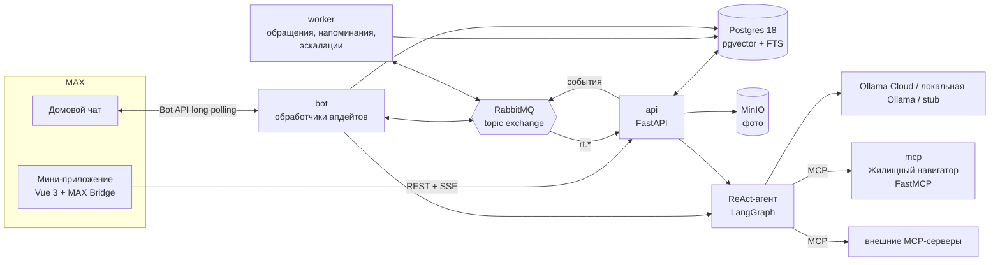

# Домовой Кузя

Чат-бот и мини-приложение MAX для жителей многоквартирного дома. Кузя живёт в домовом чате: превращает жалобы в коллективные обращения с правильным адресатом и нормативным сроком, следит за исполнением, собирает соседей на субботники, ведёт барахолку, модерирует чат и показывает ближайшие укрытия при беспилотной опасности.

Трек «Умный город». Пилот: многоквартирный дом в Казани.

## Проблема и пользователь

**Кто:** житель панельной девятиэтажки (40-150 квартир) с активным домовым чатом, чаще всего председатель совета дома или неравнодушный сосед.

**Ситуация:** в доме течёт крыша. В чате 30 сообщений «у нас тоже», никто не знает, кому писать (УК, регоператор ТКО, администрация района), какой срок устранения положен по закону и отправил ли уже кто-нибудь заявку. Обсуждение не превращается в действие, а когда заявку всё же подают, её статус никто не отслеживает.

[Житель] в ситуации [поломки общего имущества] хочет [чтобы её устранили в срок], но сталкивается с [непониманием, кто отвечает, и разрозненными жалобами в чате], из-за чего [проблема висит неделями, а жители теряют доверие к УК и друг к другу].

С 01.09.2026 управляющие организации обязаны взаимодействовать с жителями через MAX (ПП РФ № 40 от 26.01.2026). Кузя встраивается в этот канал там, где жители уже общаются: в домовой чат.

## Что делает решение

| Функция | Где | Что получает житель |
|---|---|---|
| Проблемы дома | мини-приложение, бот | фото и описание → ИИ определяет категорию, ответственного и норматив → соседи голосуют → при пороге (% от участников чата) Кузя сам формирует и отправляет обращение → таймер срока → при просрочке готовит жалобу в Госжилинспекцию |
| Поиск дублей (RAG) | мини-приложение, бот | «об этом уже сообщили, поддержите голосом» вместо десяти одинаковых заявок |
| Барахолка | мини-приложение | объявления с фото, «даром» или с ценой, связь с продавцом через бота |
| События двора | мини-приложение, бот | субботники и собрания, запись «Иду», живой чат события, напоминание от бота записавшимся |
| Ачивки и уровни | мини-приложение | очки за полезные действия, 11 ачивок, рейтинг соседей |
| Безопасность | мини-приложение, бот | карта укрытий (OpenStreetMap), маршрут в Яндекс Картах, полноэкранное оповещение о беспилотной опасности |
| Кузя-агент | бот, мини-приложение | ReAct-агент понимает, кто пишет, помнит контекст чата, создаёт события и заявки из сообщения |
| Модерация | бот, комментарии | мат, оскорбления, реклама и спам удаляются, три предупреждения → уведомление администраторам |
| MCP | агент | «Жилищный навигатор» (паспорт дома, тарифы, капремонт) и любые внешние MCP-серверы |

**Кузя - тамагочи дома.** Настроение маскота считается из реальных данных: открытые и просроченные заявки его огорчают, решённые проблемы и события радуют, во время тревоги он переходит в режим оповещения. Жителю не нужно читать отчёты, чтобы понять, как дела у дома.

**Закон не выдумывается.** LLM только выбирает категорию проблемы. Ответственный, основание и срок берутся из справочника (`backend/src/domovoy/modules/issues/catalog.py`) с ссылками на ПП РФ № 290, 354, 491, Госстрой № 170, 59-ФЗ, 131-ФЗ. В интерфейсе основание помечено как справочное.

## Основной сценарий

1. Житель в домовом чате MAX нажимает под сообщением Кузи «Сообщить о проблеме» (или открывает мини-приложение).
2. Делает фото, пишет «течёт крыша над 9 этажом». Пока он печатает, Кузя показывает: «Кровля → УК, срок 24 ч» и проверяет дубли.
3. Заявка публикуется в чате с кнопкой «👍 Поддерживаю (1/6)». Порог 6 = 15% от 40 участников чата.
4. Соседи голосуют прямо в чате или в приложении, счётчик обновляется у всех без перезагрузки.
5. На 6-м голосе Кузя формирует официальное обращение (адресат, основание, срок, число подписавшихся), отправляет исполнителю и пишет в чат срок исполнения.
6. Житель видит статус, таймер срока и текст обращения в карточке. При просрочке Кузя готовит жалобу в Госжилинспекцию и сообщает об этом в чат.
7. Когда проблему устранили, автор отмечает «Решено», жители получают очки, у Кузи улучшается настроение.

## Архитектура



Модульный монолит: один Python-пакет `domovoy`, четыре процесса из одного образа. Каждый процесс масштабируется отдельно (`docker compose up --scale worker=3`), связь через RabbitMQ.

| Компонент | Процесс | Роль |
|---|---|---|
| `api` | `domovoy api` | REST API мини-приложения, SSE-поток обновлений, эмулятор чата, Swagger |
| `bot` | `domovoy bot` | long polling MAX Bot API, модерация, агент, отправка сообщений из очереди `bot.send` |
| `worker` | `domovoy worker` | формирует обращения (очередь `issue.dispatch`), раз в минуту напоминает о событиях и эскалирует просрочки |
| `mcp` | `domovoy mcp` | MCP-сервер «Жилищный навигатор» (streamable HTTP, `/mcp`) |
| `frontend` | nginx | статика мини-приложения, проксирует `/api` в `api` |

Модули бэкенда (`backend/src/domovoy/modules`): `users`, `issues`, `market`, `events`, `achievements`, `safety`, `moderation`, `search`, `assistant`, `devchat`. У модуля свои модели, сервис и роутер; бот, агент и REST вызывают одни и те же сервисы.

**Почему REST, а не gRPC или GraphQL.** Мини-приложение работает в WebView: gRPC там требует gRPC-Web и прокси, GraphQL добавляет слой схемы и резолверов без выигрыша на десятке простых экранов. REST с узкими ответами, HTTP-кэшем для фото и SSE для живых обновлений даёт минимальную задержку и простую отладку. Контракт: [docs/API.md](docs/API.md), OpenAPI: `http://localhost:8000/openapi.json`.

**RAG-поиск.** Гибридный ретривер в Postgres: вектор pgvector (косинус) + полнотекстовый индекс с русской морфологией, веса 0,6/0,4. Эмбеддинги считает локальный хэширующий эмбеддер на символьных триграммах со словарём бытовых синонимов («протекает крыша» ≈ «течь кровли»). Он не требует сети и GPU, поэтому поиск работает и без LLM. Используется для дублей заявок, общего поиска и инструмента агента `search_house`.

**Агент.** `langchain.agents.create_agent` (LangGraph) с инструментами-замыканиями: модель не может подставить чужой `user_id` или дом. Память: `AsyncPostgresSaver`, поток на чат. В группе каждое сообщение подписано «[Имя Фамилия]: текст», агент отвечает конкретному человеку. Облачная модель при сбое падает на stub (`ModelFallbackMiddleware`), длинная история сворачивается `SummarizationMiddleware`.

## Запуск

Нужны Docker 24+ с Compose v2. Одна команда из корня репозитория:

```bash
docker compose up -d --build
```

Сборка занимает около минуты (без учёта загрузки базовых образов). Файл `.env` необязателен: без него всё стартует в мок-режиме с демо-данными.

| Адрес | Что там |
|---|---|
| http://localhost:8080 | мини-приложение (в браузере открывается в мок-режиме) |
| http://localhost:8080/dev/chat | эмулятор чата MAX с ботом |
| http://localhost:8000/docs | Swagger API |
| http://localhost:8765/mcp | MCP-сервер «Жилищный навигатор» |
| http://localhost:15672 | RabbitMQ (domovoy / domovoy) |
| http://localhost:9001 | консоль MinIO (domovoy / domovoy-secret) |

Остановка и повторный запуск:

```bash
docker compose stop            # остановить, данные сохраняются
docker compose start           # запустить снова
docker compose down            # удалить контейнеры, данные в томах остаются
docker compose down -v         # удалить и данные; при следующем запуске демо-данные создадутся заново
```

### Локально через uv

```bash
cp .env.example .env                                   # раскомментировать блок «Для локального запуска через uv»
docker compose up -d postgres rabbitmq minio           # только инфраструктура
cd backend && uv sync
uv run domovoy mcp & uv run domovoy api & uv run domovoy bot & uv run domovoy worker
cd ../frontend && npm ci && npm run dev                # http://localhost:5173
```

### Подключение к MAX

1. Получить токен бота у организаторов, записать в `.env`: `MAX_BOT_TOKEN=...`, `MAX_BOT_USERNAME=<ник без @>`.
2. Опубликовать фронтенд по HTTPS (MAX открывает мини-приложения только по HTTPS), например `cloudflared tunnel --url http://localhost:8080`.
3. В business.max.ru → Чат-боты → Настройки указать URL мини-приложения.
4. `MOCK_MAX=false`, затем `docker compose up -d`.
5. Добавить бота в домовой чат администратором (нужно для чтения сообщений и удаления спама). Пригласивший становится администратором дома в Кузе.

Эмулятор и настоящий MAX работают одновременно: демо-чат и демо-жители обслуживаются эмулятором, настоящие чаты идут через Bot API.

## Переменные окружения

Полный список с комментариями: [.env.example](.env.example).

| Переменная | По умолчанию | Назначение |
|---|---|---|
| `MAX_BOT_TOKEN` | пусто | токен бота MAX; пусто = работает только эмулятор чата |
| `MAX_BOT_USERNAME` | `domovoy_kuzya_bot` | ник бота для диплинков `https://max.ru/<ник>?startapp=...` |
| `MAX_API_URL` | `https://platform-api2.max.ru` | адрес Bot API |
| `MOCK_MAX` | `true` | вход без подписи MAX (`X-Dev-User`), демо-жители, эмулятор чата |
| `SEED_DEMO` | `true` | создать демо-дом при первом запуске |
| `LLM_PROVIDER` | `stub` | `stub`, `ollama_cloud` или `ollama_local` |
| `LLM_MODEL` | `gpt-oss:120b` | модель Ollama |
| `OLLAMA_API_KEY` | пусто | ключ Ollama Cloud |
| `OLLAMA_LOCAL_URL` | `http://host.docker.internal:11434` | локальная Ollama |
| `EXTRA_MCP_SERVERS` | `[]` | JSON со списком внешних MCP-серверов |
| `DEFAULT_VOTE_THRESHOLD_PCT` | `15` | порог голосов, % от участников чата |
| `MIN_VOTES_NEEDED` | `3` | минимальный порог для маленьких чатов |
| `EVENT_REMINDER_MINUTES` | `120` | за сколько минут напоминать о событии |
| `WEB_PORT`, `API_PORT`, `MCP_PORT`, `POSTGRES_PORT`, `RABBIT_PORT`, `RABBIT_UI_PORT`, `MINIO_PORT`, `MINIO_CONSOLE_PORT` | 8080, 8000, 8765, 5432, 5672, 15672, 9000, 9001 | порты на хосте |

## Зависимости

Версии зафиксированы в `backend/uv.lock` и `frontend/package-lock.json`.

- Бэкенд: Python 3.13, FastAPI, SQLAlchemy 2 (asyncpg), pgvector, FastStream (RabbitMQ), miniopy-async, LangChain 1.x, LangGraph 1.x, langgraph-checkpoint-postgres, langchain-ollama, FastMCP 4, sse-starlette, Pillow, structlog.
- Фронтенд: Vue 3, Vite, TypeScript, Pinia, Vue Router, Vuetify 3 (Material Design), shadcn-vue + Tailwind CSS 4, GSAP, Leaflet.
- Инфраструктура: PostgreSQL 18 + pgvector, RabbitMQ 4, MinIO.
- Инструменты: uv, ruff, mypy, pytest; ESLint, vue-tsc, Vitest.

## Внешние сервисы и интеграции

| Сервис | Зачем | Статус в MVP |
|---|---|---|
| MAX Bot API | бот в чатах | реальная интеграция, нужен токен |
| MAX Bridge (`max-web-app.js`) | данные пользователя, BackButton, вибро, открытие ссылок | реальная интеграция, подпись `initData` проверяется на сервере |
| Ollama Cloud | LLM агента, классификация, деловой стиль обращений, модерация | опционально, без ключа работает stub |
| OpenStreetMap | тайлы карты укрытий | реальная |
| Яндекс Карты | пешеходный маршрут до укрытия по координатам | ссылка `yandex.ru/maps/?rtext=...&rtt=pd` |
| Отправка обращения в УК | e-mail УК или ГИС ЖКХ | **модельная**: текст сохраняется в карточке и ленте статусов, исполнителю не уходит |
| ГИС ЖКХ (паспорт, тарифы, капремонт) | «Жилищный навигатор» | **модельные данные** в MCP-сервере, помечены в ответах |
| Реестр укрытий | карта | **демо-точки** рядом с демо-домом, в пилоте заменяются данными МЧС/муниципалитета |
| Оповещение о беспилотной опасности | тревога в чате и приложении | запускает администратор дома (или любой житель в мок-режиме); интеграция с региональной системой оповещения после MVP |

Внутри Docker не воспроизводятся только MAX и Ollama Cloud. Без них проверка идёт через эмулятор чата и stub-LLM.

## Работа с данными

- Персональные данные: имя, фамилия, ник и фото из MAX, номер квартиры (указывается добровольно). Телефоны не собираются.
- Фото перед сохранением пересжимаются до 1600 px, EXIF (включая геотеги) удаляется, в MinIO лежат только JPEG.
- Журнал модерации хранит только сработавшие сообщения; обычная переписка в БД не сохраняется. Память агента хранит диалоги с ботом (Postgres, таблицы `checkpoint*`).
- Доступ: житель видит только данные своего дома; менять статус заявки может автор или администратор, объявление и событие только автор.
- Секреты только в `.env`, в репозитории `.env.example` без значений.

## Тестовые данные

При первом запуске (`SEED_DEMO=true`) создаётся синтетический дом «Дом 7 на Демонстрационной» (Казань, демо-адрес) с 40 участниками чата и порогом 6 голосов:

- 8 демо-жителей (MAX id 1001-1008), Анна Иванова (1001) администратор дома;
- 5 заявок в разных статусах: на голосовании, отправленная, просроченная (для демонстрации эскалации), решённая;
- 5 объявлений, 3 события (субботник в ближайшую субботу, собрание, прошедший праздник);
- 6 демо-укрытий, демо-УК и справочник исполнителей.

Все организации, адреса и укрытия вымышленные и помечены «(демо)». Сбросить данные: `docker compose down -v && docker compose up -d`.

## Пошаговая проверка

Автоматически (стенд должен быть запущен):

```bash
uv run --project backend python scripts/smoke.py
```

Скрипт проходит 16 проверок: заявка с фото, классификация, поиск дублей, голосование до порога, обращение от воркера, модерация, создание события агентом в чате, удаление спама, укрытия и тревога, ачивки.

Вручную в браузере:

1. Откройте http://localhost:8080. В шапке выберите жителя «Светлана Козлова».
2. Главная: Кузя встревожен (есть просроченная заявка), видно здоровье дома и статистику.
3. «Проблемы» → «Сообщить»: добавьте фото, введите «течёт кран в подвале». Появится подсказка категории и ответственного, затем карточка заявки 1/6.
4. Переключайтесь на других жителей и нажимайте «Поддерживаю». На 6-м голосе статус станет «Отправлено исполнителю», через пару секунд появится текст обращения и таймер срока.
5. «Ещё» → «Эмулятор чата MAX»: видно сообщения Кузи о заявке. Напишите «Кузя, создай субботник в воскресенье в 12 у площадки», событие появится в чате и во вкладке «События».
6. Напишите в эмуляторе «Ты дурак, блин»: сообщение удалится, Кузя выдаст предупреждение 1/3.
7. «Ещё» → «Безопасность» → «Тестовая тревога»: на всех открытых вкладках появится оповещение с ближайшим укрытием и маршрутом.
8. «Ещё» → «Чат с Кузей»: «Какие тарифы на воду?» (ответ из MCP-сервера), «Какие проблемы в доме?».

### Примеры ожидаемого поведения

| Действие | Результат |
|---|---|
| `POST /api/v1/issues` с «пахнет газом в подъезде» | категория «Запах газа», заявка сразу уходит в аварийную службу без голосования, в чате инструкция звонить 104/112 |
| 6-й голос за заявку | статус `sent`, `deadline_at` = сейчас + норматив, через 1-2 с `appeal_text` заполнен |
| Комментарий «Ты дурак» | `422 {"detail": "Кузя не пропустил комментарий: оскорбление. Давайте вежливо 🙏"}` |
| В чате «Кузя, где укрытие?» | список трёх ближайших укрытий со ссылками на маршрут в Яндекс Картах и кнопка «Карта укрытий» |
| Просрочка нормативного срока | в ленте заявки появляется текст жалобы в Госжилинспекцию, Кузя сообщает в чат, настроение Кузи падает |
| Повторный голос | `409 {"detail": "Вы уже поддержали эту заявку"}` |

## Проверки качества

```bash
cd backend && uv run ruff check . && uv run mypy src && uv run pytest
cd frontend && npm run lint && npm run typecheck && npm test && npm run build
```

## Известные ограничения

- Отправка обращения исполнителю модельная: нужна договорённость с УК об e-mail или интеграция с ГИС ЖКХ.
- Нормативные сроки и основания в справочнике справочные, перед пилотом их должен подтвердить юрист УК; для других регионов справочник дополняется.
- Долгий опрос MAX (long polling) по документации не рекомендован для продакшена; для пилота нужен webhook (`POST /subscriptions`) и публичный HTTPS-адрес бота.
- `open_app`-кнопки отправляются в MAX как ссылки-диплинки `https://max.ru/<бот>?startapp=...`, поскольку формат поля `web_app` в документации не описан.
- Участников чата бот узнаёт из `GET /chats/{id}` (`participants_count`), поэтому для корректного порога бот должен быть в чате.
- Хэширующий эмбеддер уступает нейросетевым в семантике; для крупных домов стоит подключить эмбеддинги Ollama (размерность `EMBEDDING_DIM`).
- Реестр укрытий и оповещения демонстрационные; реальные данные даёт МЧС или муниципалитет.
- Миграции схемы не используются (`create_all` при старте); для продакшена нужен Alembic.
- Добавлять внешние MCP-серверы может только администратор дома: сервер обращается по указанному URL.

## Масштабирование

Что не меняется при переносе в другой дом, УК или регион: сценарий «фото → голоса → обращение → контроль срока», модель данных, бот, мини-приложение, агент.

Что адаптируется: справочник исполнителей и нормативов (`issues/catalog.py`, таблица `organizations`), региональные тарифы и капремонт (MCP-сервер, в пилоте ГИС ЖКХ и региональный фонд), реестр укрытий, канал отправки обращения в конкретную УК.

Порядок тиражирования: один дом в Казани → все дома одной УК (один справочник, один канал отправки) → УК Казани через ассоциацию ТСЖ → другие регионы с новым справочником норм. Подробнее: [docs/PRODUCT.md](docs/PRODUCT.md).

## Структура репозитория

```
backend/            Python-пакет domovoy (api, bot, worker, mcp), тесты, Dockerfile
  src/domovoy/core      конфиг, БД, шина, хранилище, подпись MAX, эмбеддинги, SSE-хаб
  src/domovoy/modules   доменные модули: модели, сервисы, роутеры
  src/domovoy/agent     ReAct-агент, инструменты, MCP-адаптер, stub-LLM
  src/domovoy/bot       клиент MAX Bot API, шлюзы MAX/эмулятор, обработчики
  src/domovoy/worker    обращения, напоминания, эскалации
  src/domovoy/mcp_server  MCP-сервер «Жилищный навигатор»
frontend/           мини-приложение Vue 3, Dockerfile, nginx.conf
docs/               контракт API, продуктовое обоснование
scripts/smoke.py    сквозная проверка стенда
compose.yaml        запуск всех компонентов одной командой
```
